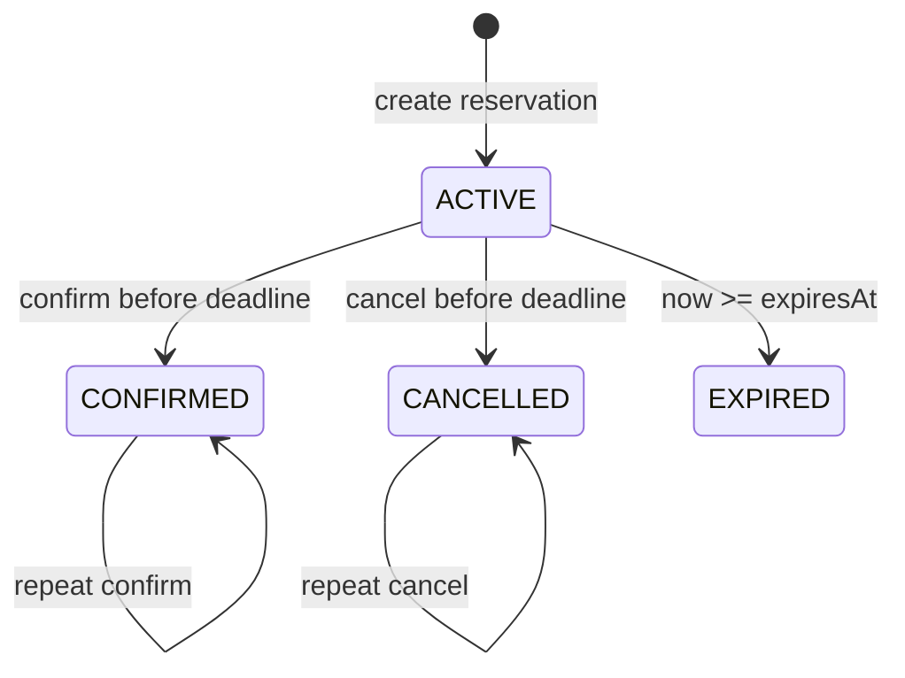

# ReserveLedger-Spring：Spring Boot 库存预占服务（赛道 t1-spring）

版本：1.0.0（赛道 t1-spring）。本文是实现与验收的权威契约。业务与 HTTP 契约和 JDK 版 ReserveLedger 完全相同；不同的是技术栈：你需要用 **Spring Boot + Spring Data JPA + Flyway + H2** 交付真正可运行的后端服务及 JUnit 黑盒契约测试，不是设计稿或伪代码。

## 1. 目标与边界

实现一个单进程、单节点的库存预占服务，支持创建库存、多商品原子预占、确认、取消、到期释放、幂等重试、分页查询和数据库持久化恢复。所有业务状态必须由你实现。

这不是完整电商系统。不要实现用户、支付、订单金额、前端、第三方登录、分布式锁、消息队列、集群一致性或微服务。可以使用你熟悉的 Spring 设计；不用设计模式数量或抽象层数换分。

技术栈固定：Spring Boot 3.5.16、Java 21（`maven.compiler.release=21`）、Spring Web MVC、Spring Data JPA（Hibernate）、Bean Validation、Flyway、H2 文件数据库、JUnit 5。依赖由冻结的 `pom.xml` 给出，**不能增删依赖或插件**：裁判使用自己保存的同一份 pom 构建，你对 pom 的修改不会生效，并且会让交付检查失败。

构建只能离线进行：工作区的 `.mvn/maven.config` 已把 Maven 指向操作者准备的离线仓库（`-o`）。不得联网下载依赖、引入 JAR/预编译二进制、运行外部服务或调用网络 API。正式裁判不执行你的构建脚本，而是取你的 `src/main` 用冻结 pom 独立编译。

建议固定开发预算为 180 分钟；这是实验条件，不是保证能够完成的承诺。优先正确性，再补齐测试和性能。最终回答不能代替源码交付。

## 2. 工程与启动协议

必须保留入口类 `app.Main`（`src/main/java/app/Main.java`），它是 `@SpringBootApplication`。生产代码放 `src/main/java`，资源放 `src/main/resources`；包名不限，但不得使用 `benchjudge`。不得提交 `.class`、`.jar`、动态库或符号链接；`target/` 与 `.mvn/` 不会进入评测快照。

裁判以 classpath 方式启动（不打 fat jar），参数为 Spring 标准的 `--key=value` 形式，顺序可能改变，数据路径可能含空格：

```bash
java -Xms64m -Xmx512m -XX:ActiveProcessorCount=2 -cp <classes:依赖> app.Main \
  --server.port=8080 --server.address=127.0.0.1 \
  --spring.datasource.url='jdbc:h2:file:/path/to/data dir/reserveledger;WRITE_DELAY=0;LOCK_TIMEOUT=10000' \
  --bench.clock=manual --bench.now=1700000000000
```

| 属性 | 默认值 | 语义 |
|---|---|---|
| `server.port` | `8080` | 由裁判给出；仅监听 `server.address=127.0.0.1` |
| `spring.datasource.url` | 无 | **由裁判给出**，指向本次运行的数据目录；全部持久化业务数据必须在这个数据库里，不同目录完全隔离。不要在代码里写死数据源 |
| `bench.clock` | `system` | `system` 或 `manual` |
| `bench.now` | `1700000000000` | 手动时钟初值，整数 0..8000000000000000；系统时钟模式不依赖该值 |

非法 `bench.clock`/`bench.now`、端口占用、数据库被另一个进程占用，都必须启动失败并以非 0 退出，不能假装健康。启动完成（含 schema 迁移和状态恢复）后 `/health` 才能报告健康。同一数据库文件只允许一个服务进程持有（H2 文件锁会拒绝第二个进程，你不应绕过它）。服务不得自行清空数据。普通终止、强制杀死 JVM 后，用同一数据目录重启应恢复。

**Schema 必须由 Flyway 版本化迁移管理**（`src/main/resources/db/migration/V*.sql`），Hibernate 不得自动建表或改表：`spring.jpa.hibernate.ddl-auto` 只能是 `none` 或 `validate`。

资源包络：JVM 堆上限 512 MiB。功能测试最多 32 个同时发起的客户端。标准性能数据为 1500 个 ACTIVE 预占加少量终态记录。服务不得人为识别测试请求、种子、模型名称、裁判路径或数据集，然后返回硬编码结果。

## 3. 通用 HTTP 与 JSON 规则

所有响应，包括错误，均为 UTF-8 JSON，`Content-Type: application/json`（允许 `; charset=utf-8`）。响应可以增加不会改变语义的字段；本文列出的字段必须存在且类型正确。状态与字段名称大小写敏感。

POST 请求要求 `Content-Type` 的媒体类型是 `application/json`，大小写不敏感，允许 charset 参数；缺失/其他媒体类型返回 415。请求体至多 **65536 字节，含所有空白**；大于该值返回 413，恰好该值应正常处理。必须拒绝无效 UTF-8、无效 JSON、重复对象键、非对象根节点、尾随非空白内容。依赖中已有 Jackson，不需要自己实现 JSON parser；但上述严格性要求由你保证，框架默认行为不一定满足。

所有业务整数字段必须是 JSON **整数词法形式**：不得接受字符串、布尔、null、小数或指数形式。例如 `1` 有效，`"1"`、`true`、`1.0`、`1e0` 无效。使用 64 位整数处理中间值、时间与 ID，避免溢出。

请求对象字段必须恰好是接口列出的字段；缺失、拼错、未知字段返回 400。预占明细对象也一样。确认/取消的请求体必须是 `{}`，不是空字节。GET 不要求请求体。

精确匹配路由，不得因 HTTP server 的前缀匹配而将 `/healthz` 当作 `/health`。未知路由 404；已知路由的错误 HTTP 方法 405。除预占列表外，接口不接受查询参数。列表拒绝未知参数、重复参数或非法值。错误情况下不允许泄露堆栈、源码路径或系统机密。

推荐判断优先级：路由存在性 → 方法 → 测试接口权限 → Content-Type → 请求体大小/JSON → 字段约束 → 业务规则。正式测试不会利用多个无关错误同时存在的歧义推翻合理实现。

错误格式：

```json
{"error":{"code":"INSUFFICIENT_STOCK","message":"Not enough stock"}}
```

`message` 为非空字符串，具体文字不限。冻结的状态码/错误码如下：

| HTTP | code | 场景 |
|---:|---|---|
| 400 | `INVALID_REQUEST` | JSON/字段/类型/范围/查询参数错误 |
| 403 | `FORBIDDEN` | 手动测试接口令牌缺失或错误 |
| 404 | `NOT_FOUND` | 路由、商品、预占不存在；系统时钟模式的测试接口 |
| 405 | `METHOD_NOT_ALLOWED` | 已知路由的错误方法 |
| 409 | `ITEM_EXISTS` | SKU 重复创建 |
| 409 | `INSUFFICIENT_STOCK` | 任意一个明细库存不足 |
| 409 | `IDEMPOTENCY_CONFLICT` | 已成功使用的 requestId 对应不同有效载荷 |
| 409 | `INVALID_STATE` | 不允许的状态转换 |
| 413 | `PAYLOAD_TOO_LARGE` | 请求体大于 65536 字节 |
| 415 | `UNSUPPORTED_MEDIA_TYPE` | 请求的媒体类型不支持 |
| 503 | `STORAGE_ERROR` | 数据库写事务提交失败，操作没有提交 |
| 500 | `INTERNAL_ERROR` | 意外内部错误；正常合法场景不应产生 |

## 4. 数据模型与不变量

商品字段：`sku`、`total`、`available`、`held`、`sold`。

```text
total = available + held + sold
available >= 0; held >= 0; sold >= 0
```

`sku` 匹配 `[A-Za-z0-9_-]{1,32}`。创建后 total 不再改变。本题没有库存更新/补货接口。预占占用 available→held；确认 held→sold；取消/过期 held→available。每次转换只发生一次。

预占字段：`id`、`requestId`、`state`、`createdAt`、`expiresAt`、`lines`。

`id` 是服务分配的**正十进制整数字符串**，例如 `"1"`，不是 JSON 数字。它必须唯一、创建顺序递增、跨重启不会复用；允许空洞，不能要求 UUID。客户端查询的 ID 使用十进制字符串；不存在的合法 ID 返回 404。分页按 ID 的**数值**排序，不能按字符串字典序排序。

`requestId` 匹配 `[A-Za-z0-9_-]{1,64}`，大小写敏感。所有时间是整数毫秒。返回的 lines 必须按 sku 的 ASCII 字典顺序升序排列。



其余状态转换都非法；EXPIRED 不接受 confirm/cancel。确认/取消重复调用的幂等性见后文，不能重复调整库存。

## 5. 全部接口

### 5.1 健康检查

`GET /health` → 200：

```json
{"status":"ok"}
```

不得依赖外网，不修改业务数据，不产生数据库写事务。

### 5.2 创建商品

`POST /v1/items`：

```json
{"sku":"A","quantity":10}
```

quantity 为 0..1000000000 的整数；0 合法。SKU 不存在时 → 201：

```json
{"sku":"A","total":10,"available":10,"held":0,"sold":0}
```

已存在返回 409/ITEM_EXISTS，不覆盖原始数据，即使新 quantity 与原值相同也返回 409。失败不能创建或修改商品。

### 5.3 查询商品

`GET /v1/items/{sku}` → 200，结构同上。不存在 → 404/NOT_FOUND。返回前必须反映截至当前时间应发生的过期释放。

### 5.4 创建预占

`POST /v1/reservations`：

```json
{
  "requestId":"request_001",
  "lines":[{"sku":"B","quantity":2},{"sku":"A","quantity":3}],
  "ttlMillis":10000
}
```

lines 为 1..20 项数组，每个 sku 不得重复。每项 quantity 为 1..1000000000 整数。ttlMillis 为 1..86400000 整数。

首次成功 → 201：

```json
{
  "id":"1",
  "requestId":"request_001",
  "state":"ACTIVE",
  "createdAt":1700000000000,
  "expiresAt":1700000010000,
  "lines":[{"sku":"A","quantity":3},{"sku":"B","quantity":2}]
}
```

业务顺序：先验证结构，再检查成功幂等记录，再检查全部 SKU 是否存在，再检查全部库存是否足够。任一 SKU 不存在 → 404；否则任一库存不足 → 409。批量预占要么全部成功，要么完全无业务变化；不能先扣 A 再发现 B 不够。

所有失败（验证失败、SKU 不存在、库存不足、STORAGE_ERROR）都**不占用 requestId**。客户端之后可以修复条件并使用原键重试。

### 5.5 幂等精确定义

同一成功 requestId 对应的规范化业务载荷为：**按 sku 排序的 (sku, quantity) 集合 + ttlMillis**。JSON 对象字段顺序、lines 顺序不影响等价性。requestId 自身是索引键。

相同键、等价载荷 → 200，返回**原预占的当前状态**。id、createdAt、expiresAt 不变，不重新预占、不续期、不增加统计数量、不产生写事务。即使原记录已 CONFIRMED/CANCELLED/EXPIRED，也返回同一个记录的当前终态。

相同键、不等价但字段有效的载荷 → 409/IDEMPOTENCY_CONFLICT；不能改写原记录。冲突判断优先于重新检查库存是否充足或 SKU 是否存在。

并发相同键：恰好一个首次成功请求获得 201，其余等价成功请求获得 200，而且全部返回相同 id。如果请求内容冲突，允许任意一个载荷胜出，但其他不同载荷必须返回 409。

成功幂等记录必须跨重启保留，终态不能被当成“键已过期”删除。

### 5.6 查询预占

`GET /v1/reservations/{id}` → 200，返回完整预占。不存在 → 404。到期状态应在返回前生效。

### 5.7 确认

`POST /v1/reservations/{id}/confirm`，请求体 `{}`。

ACTIVE 且 `now < expiresAt` → CONFIRMED，200；held 转为 sold。已 CONFIRMED 再次确认 → 200，返回原记录，不再扣账。CANCELLED/EXPIRED → 409/INVALID_STATE；不存在 → 404。

在恰好到期时刻，应先过期，确认必须失败，不能因处理顺序错误而成功。

### 5.8 取消

`POST /v1/reservations/{id}/cancel`，请求体 `{}`。

ACTIVE 且未到期 → CANCELLED，200；held 释放回 available。已 CANCELLED 再次取消 → 200，但不重复释放。CONFIRMED/EXPIRED → 409/INVALID_STATE；不存在 → 404。

confirm 与 cancel 并发时，只允许一种终态胜出；另一种操作返回 409。同种操作的后续重试可以 200。任何调度下都要满足库存守恒。

### 5.9 列表与过滤

`GET /v1/reservations?after=0&limit=20&state=ACTIVE`

| 参数 | 默认 | 约束 |
|---|---|---|
| after | `0` | 非负十进制整数，按数值排除所有 id ≤ after 的记录；不要求游标真实存在 |
| limit | `20` | 整数 1..100 |
| state | 无过滤 | ACTIVE/CONFIRMED/CANCELLED/EXPIRED，区分大小写 |

参数只允许上述三个，拒绝重复键、空值、负值、非数值或 64 位溢出。十进制前导零可接受，返回的 id 使用通常的正十进制形式。

按 ID 数值升序，先应用 after/state 再取 limit 条。返回：

```json
{"items":[{"id":"1","requestId":"r1","state":"ACTIVE","createdAt":1700000000000,"expiresAt":1700000010000,"lines":[{"sku":"A","quantity":1}]}],"nextAfter":"1"}
```

仅当**仍有更多符合过滤条件的记录**时，nextAfter 等于本页最后一个 id；否则必须是 JSON null。空页为 `{"items":[],"nextAfter":null}`。稳定状态下连续翻页必须无重复、无遗漏。并发写入期间不要求跨请求快照隔离；每一次列表响应内部必须自洽。

### 5.10 统计

`GET /v1/stats` → 200：

```json
{"items":2,"reservations":4,"active":1,"confirmed":1,"cancelled":1,"expired":1,"now":1700000000001}
```

items 为商品个数；reservations 为全部成功创建的预占个数；四种状态计数之和等于 reservations；错误与幂等重试不能增加个数。返回前处理到期状态。数字都为 JSON 整数。

### 5.11 手动时钟测试接口

仅 `bench.clock=manual` 时存在：`POST /__test__/advance`。

环境变量 `BENCH_TEST_TOKEN` 由裁判设置。请求头 `X-Test-Token` 必须完全相同且非空；否则 403/FORBIDDEN。系统时钟模式始终返回 404/NOT_FOUND，不因提供正确令牌而开启。

请求 `{"millis":10}`，millis 为整数 0..86400000，并且新 now 不超过 8000000000000000。成功 → 200 `{"now":1700000000010}`。增量累加、原子执行、持久化；并发推进不丢增量。0 合法。不允许时钟倒退。

手动模式不得偷偷读取真实时间触发过期，也不要使用 sleep 作为正确性基础。普通接口不自动推进手动时间。

## 6. 时间与恢复语义

到期条件是 `now >= expiresAt`。可用惰性清理，无需背景定时线程；商品读取、预占操作、列表、统计等可观察操作都必须看到到期后的正确状态。已确认/已取消记录不再参与到期释放。

业务错误不会创建新实体、改变成功幂等映射或额外扣减库存；已经到期的记录允许在请求处理前被清理，这不算错误请求引入的业务副作用。

手动时钟重启后的最终可见时间为：`max(恢复出的持久化手动时间, bench.now 初值)`。如果新初值更大，应在**历史恢复完成后**按最终时间处理仍 ACTIVE 的记录；如果初值更小，不得回拨。

系统时钟从系统获取毫秒时间；进程内不能因时间回拨把已终态记录复活。重放历史时必须恢复当时已成功的终态，而不是用今天的时间提前过期后又重复扣减。系统时钟的性能测试不依赖真实长时间等待；可用 manual 模式确定性验收绝大多数时间边界。

## 7. 持久化、事务与可注入故障

所有业务数据都持久化在裁判给出的 H2 数据库中。表结构、实体映射、事务边界、锁策略由你设计；内存缓存可以有，但数据库是唯一真源，重启后状态只能来自数据库。

服务返回写入成功前，相关数据库事务必须已经提交。**每个成功的写操作在恰好一个数据库事务中提交**：成功新建商品、成功新建预占、首次成功确认/取消、时钟推进各提交一个写事务；启动、健康检查、普通读取、有效载荷等价重试、重复终态操作、业务验证失败都不应提交写事务。到期释放需要写库时，允许在处理请求时额外提交（不强制持久化 EXPIRED 状态，只要重启后可确定性推导出同样结果）。不要把一个业务操作拆成多个独立提交，也不要在 auto-commit 模式下执行多条写语句。

`BENCH_FAIL_APPEND_AT=N` 由裁判在启动环境中设置：本进程启动完成后的第 N 次写事务提交尝试会失败一次（JDBC 层抛出 `SQLException`，事务未提交）。故障由裁判在 JDBC 层注入，你不能也不需要读取这个变量；你只会看到 Spring 的事务/数据访问异常。此时必须返回 503/STORAGE_ERROR，数据库与任何内存状态、幂等键都不能提交；对外返回 503 后，同键重试必须能正确成功，服务继续可用。例如“创建商品成功→预占提交失败→原键重试成功”是必须支持的场景。

裁判会测量读请求发出的 SQL 往返次数（N+1 查询会被计入性能维度），并在并发写入中途强制杀死进程，检查已应答写入全部恢复、库存守恒。

本题不是断电、磁盘损坏或数据库文件损坏的完整验证，不要声称获得生产级数据库可靠性。

## 8. 并发与性能要求

外部 HTTP 请求可能真正并发。操作结果应能解释为某个遵守实时先后关系的串行顺序，允许竞争请求中任意合法赢家。任何时刻的成功返回和最终状态必须满足守恒、单次终态转换和单次幂等创建。

单全局锁是允许的，只要满足正确性与资源要求。不因使用 synchronized 自动扣分，也不因使用 ConcurrentHashMap 自动加分。多个线程安全集合不能自动提供跨集合事务。

读取、生命周期写入、数据规模增长和进程 RSS 都会实测。性能仅在相应负载结果正确时计分；快速返回错误、跳过持久化、减少检查不能获得吞吐分。性能相对同机固定参考实现归一化；不要求达到某台未知机器上的固定 QPS。

## 9. 自测交付

必须提交 JUnit 5 黑盒契约测试，放在 `src/test/java/contract/`（包名 `contract`）。它们**只能依赖 JDK、JUnit Jupiter 和 Jackson**（`com.fasterxml.jackson.databind`），通过 HTTP 访问已经启动的服务：

- 服务地址来自环境变量 `BENCH_BASE_URL`（例如 `http://127.0.0.1:8080`），测试令牌来自 `BENCH_TEST_TOKEN`；
- 服务由裁判启动，数据库为新的空目录，手动时钟模式；
- 测试不得启动/停止服务或 Spring 上下文，不得引用 `app` 包中的生产类，不得读写服务数据目录或裁判文件；
- 使用独特 SKU/requestId 组织 fixture；必要时调用手动时钟接口。

裁判只编译 `src/test/java/contract/` 下的源码（classpath 只有 JUnit + Jackson），用 JUnit Platform Console Launcher 扫描执行（不要求类名以 Test 结尾）。任何测试失败即非 0 退出。

裁判先在正确实现上用两次全新服务执行你的测试；在正确实现上失败的测试方法会被剔除，并按保留比例折算这一维度（超过一半失败、或失败无法归属到具体测试方法时为 0）。之后在十个常见业务缺陷实现上执行同一组测试，每检出一个缺陷加 1 分，满分 10。超时不计为有效检出。

你可以额外编写 Spring 上下文测试、MockMvc、`@DataJpaTest` 等白盒测试（放在其他包），用于自己开发；它们不计入这一维度，也不会被裁判执行。

## 10. 最终交付清单

交付完整工作目录，包括生产源码、Flyway 迁移、契约测试、`README.md`、`DESIGN.md`、`TESTING.md`。三个文档分别解释启动/使用；实体与表结构、事务边界、并发/锁策略、恢复与取舍；测试命令、覆盖范围、真实执行结果与已知限制。

最终说明写清：实现了哪些功能、实际运行过什么测试、仍有哪些已知问题。不得声称没跑过的测试已通过，不得改写冻结契约或降低测试标准。未完成的功能保留真实失败，由裁判计 0；不要隐藏。

`python3 dev.py build`、`python3 dev.py run`、`python3 dev.py contract` 可用于开发。任何隐藏用例都只能检验本文已公开的要求，不会临时加入新的业务需求。
